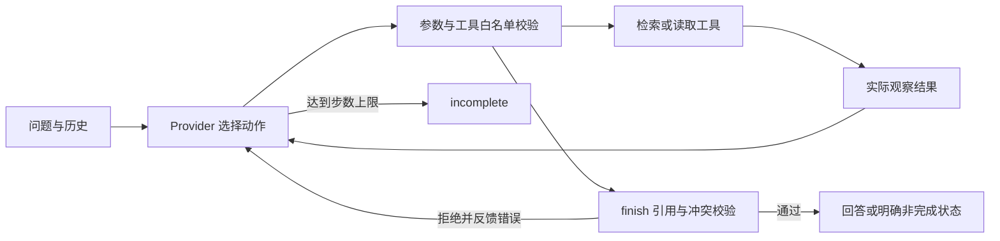

# 方案、动态决策与取舍

## 架构

`Agent.run` 是统一执行骨架。每一轮调用 `provider.next(request, events)` 获得一个动作，执行后记录实际观察，再调用模型。引擎不会根据“查到冲突”硬编码选择搜索、重试或结束；这些动作由真实模型入口决定。引擎只强制边界和结果有效性。

`ResponsesProvider` 通过原生 HTTP 调用 Responses API；`tool_choice=required` 要求输出函数动作，`parallel_tool_calls=false` 将每步约束为一个动作。全部工具观察通过 `function_call_output` 关联 `call_id` 传回。`finish` 也是一个模型可选择的函数，参数包含状态、引用、缺口及公开的一句理由。模型没有自由改写业务事实的输出通道。

`MockProvider` 是确定性测试策略，可查看实际观察并改变下一动作，但**不是模型，也不计为 ReAct 实现证明**。它用于隔离模型的不确定性，验证工具和运行时。`StdioProvider` 是外部模型/操作员的逐步通信桥，不自带模型；本次通过当前 Codex 会话选择动作，详情见记录来源说明。

## 工具和动态路径

| 工具 | 参数 | 返回/作用 |
|---|---|---|
| search_documents | query, reason | 文档元数据；返回命中主题的全部兄弟文档，避免只取 top-1 漏冲突 |
| read_document | doc_id, reason | 已发现文档的完整原文、日期、范围、优先级；或结构化错误 |
| finish | status, citations, gaps, reason | 验证后结束；验证失败作为 observation 返回，让模型调整 |

实际交互路径：

- 正常：搜索字幕 → 读 P01 → answered。
- 冲突：搜索报销期限 → 读 D01 → 观察 30 天 → 读 D02 → 观察 15 天 → 按主题补查范围与优先级 → conflict。
- 缺资料：搜索宠物保险 → 0 条 → 改写为员工福利/保障 → 0 条 → insufficient_evidence。
- 临时故障：搜索 → 读 P01 失败且 retryable → 模型选择重读 → 原文成功 → answered。
- 永久故障：搜索 → 读 D01 成功 → 读 D02 不可重试 → incomplete，保留 D01 部分证据。

这些路径在 `examples/live/` 中是实际逐步交互结果。程序没有针对这些样例预存最终答案或预制 Trace。

## 证据与冲突保护

1. 检索不返回正文，模型必须请求读取后才能引用。
2. 引用 ID 必须实际成功读取；quote 必须逐字等于完整 text。不能截掉否定词或适用条件。
3. 按 `policy_key` 扩展同主题全部候选，模型不能仅读 D01 就回答 30 天。
4. 对需要作答的引用主题，未读候选会阻止 answered/conflict 结束。
5. 同一主题不同原文视为潜在冲突；不能凭版本日期推断覆盖关系。conflict 必须列出双方。
6. answered 由固定前缀与已核验引用渲染，不能新增“提升80%”等无来源事实。

冲突算法保守且适用于本次短制度段落：两个语义相同但措辞不同的版本也可能被要求澄清。不同适用范围也不会自动推断谁优先。扩大语料后需要更细粒度的规则对象和明确适用范围解析，不能简单靠日期排序。

## 状态、错误与上限

每次 run 独立维护 discovered、read、events，成功结果在后续失败后仍保留在 Trace。故障计数位于工具实例内：正整数表示失败次数，-1 表示持续失败，0 表示正常。重试动作由模型选择，不是运行时自动重试。

默认最多 12 个动作（包含 finish），最大配置 50；无结束动作则输出 incomplete/MAX_STEPS。API 每轮超时 30 秒，异常返回明确 incomplete，不会伪造成功或切换 Mock。stdio 可能等待外部输入，没有墙钟时间上限；它仅用于人工/模型桥接，不能当生产服务运行时。

CLI 使用临时文件加原子替换写出 Trace，避免中断留下半个 JSON；最终写入失败不会打印成功。每条记录有步骤、参数、完整工具结果、摘要、后续动作和公开决策依据，不包含内部思维过程。

## 技术取舍

Python 标准库可免安装运行，也使工具协议和控制循环可直接审阅。不采用 Agent 框架，因此无框架版本和职责需要转述。JSON Schema 只实现本项目用到的 object/array/string/enum 子集；不是通用 JSON Schema 库。

检索使用人工同义词和关键词，再以 policy_key 补全候选。相比引入向量库，它适合 3 小时内的小型演示，但泛化能力有限。当前未构建语义相关性判定器：引用能证明“原文这么说”，不能单独证明“引用完整回答了任何复杂问题”。此部分依赖模型与人工评估。

API 实现参考 [Function calling](https://developers.openai.com/api/docs/guides/function-calling) 和 [Reasoning models](https://developers.openai.com/api/docs/guides/reasoning)，于 2026-10-28 核对。无状态请求保留 API 返回的连续上下文，支持加密 reasoning item 转交，但不公开记录内容。API 适配器的合同测试不等于服务端真实调用成功。
